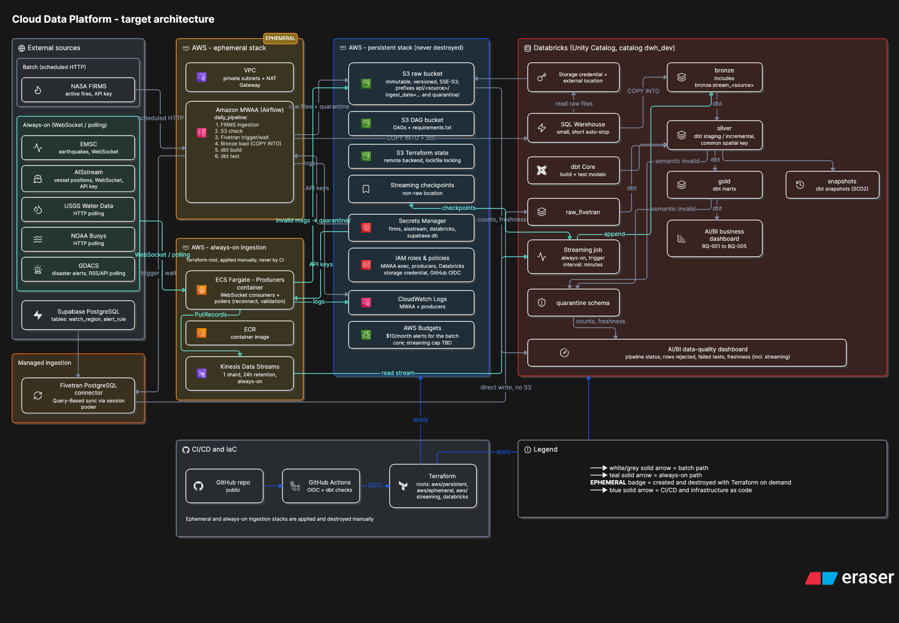

# Cloud Data Platform

End-to-end, 100% cloud data platform for **Earth monitoring**: hazards (earthquakes, fires, floods, disasters) and maritime activity, ingested from six public sources and an operational database (Supabase PostgreSQL via Fivetran), a medallion architecture on Databricks, dbt transformations, Unity Catalog governance and infrastructure as code.

> The sources are real; the pipeline that ingests, transforms and governs them is real too.

## Architecture



Full details: [Technical Datasheet (PDF)](docs/technical_datasheet.pdf)

Notion Plan - https://app.notion.com/p/NOTION_PROJECT_PLAN-a0545b08c0b682c9adac81d55a468fd1?source=copy_link

## Stack

| Layer | Technology |
|---|---|
| Cloud / Storage | AWS, S3 |
| Orchestration | Amazon MWAA (Apache Airflow) |
| Ingestion (batch) | Python (scheduled HTTP APIs) |
| Ingestion (streaming) | Python WebSocket producers on ECS Fargate, Amazon Kinesis (ADR-010, ADR-008) |
| Ingestion (database) | Fivetran (Supabase PostgreSQL) |
| Lakehouse | Databricks, Delta Lake |
| Governance | Unity Catalog |
| Transformation | dbt-core, dbt-databricks |
| BI | Databricks AI/BI |
| IaC | Terraform |
| CI/CD | GitHub Actions (OIDC) |
| Secrets | AWS Secrets Manager |

## Data Sources

| Source | Type | Mode | Path |
|---|---|---|---|
| **EMSC** (earthquakes) | WebSocket feed | Streaming | Producer → Kinesis → Databricks Streaming → Bronze (ADR-008) |
| **AISstream** (vessel positions) | WebSocket feed | Streaming | Producer → Kinesis → Databricks Streaming → Bronze (ADR-008) |
| **NASA FIRMS** (active fires) | Scheduled HTTP API | Batch | Airflow → S3 → Bronze |
| **USGS Water Data** (river gauges) | HTTP polling | Micro-batch | Airflow → S3 → Bronze |
| **NOAA** (ocean buoys) | HTTP polling | Micro-batch | Airflow → S3 → Bronze |
| **GDACS** (disaster alerts) | RSS/API polling | Micro-batch | Airflow → S3 → Bronze |
| **Supabase PostgreSQL** | Fivetran connector (PostgreSQL) | Managed sync | Fivetran → Databricks (schema: raw_fivetran) |

Streaming ingestion is proposed in ADR-008; the producers' runtime is proposed in ADR-010. Details and status per source: `docs/data-sources.md`.

## Data Layers

- **S3 Raw/Landing:** immutable source payloads, partitioned by ingestion date; streaming payloads land as micro-batches with the same guarantee
- **Bronze:** data close to the source, with technical metadata (`_batch_id`, `_ingested_at`, `_source_file`, `_source_system`, `_batch_date`)
- **raw_fivetran:** Fivetran-managed landing area for the operational database (schema name confirmed in P8)
- **Silver:** types, deduplication, normalization and business rules (dbt staging)
- **Gold:** analytical dimensions and facts (dbt marts)
- **Quarantine:** records rejected by validations (structural → S3, semantic → Databricks)
- **Snapshots:** dbt snapshot history using SCD2 where historical tracking is required

The questions the platform answers are in `docs/business-questions.md`; the data quality questions are tracked alongside them.

## Repository Structure

```
├── ingestion/        # extraction code (APIs, streaming producers) and Fivetran config
├── orchestration/    # Airflow DAGs
├── dbt_project/      # models, snapshots, tests, macros
├── infra/terraform/  # AWS (persistent, ephemeral, streaming) and Databricks
├── docs/             # datasheet, diagrams, ADRs, runbooks, evidence
├── tests/
└── .github/workflows/
```

## Getting Started

**Prerequisites:** AWS account, Databricks workspace (AWS), Terraform, Python 3.11+, dbt-core with dbt-databricks.

```bash
# 1. Infrastructure
cd infra/terraform/aws/persistent && terraform init && terraform plan
cd ../ephemeral && terraform init && terraform plan   # MWAA, apply/destroy manually
cd ../../databricks && terraform init && terraform plan

# 2. Python dependencies
pip install -r requirements.txt

# 3. dbt
cd dbt_project
dbt deps
dbt build
```

Credentials and API keys live in AWS Secrets Manager, never in the repository.

## CI/CD

| Event | Actions |
|---|---|
| Pull Request | tests, `dbt parse`, DAG import test, lint, gitleaks, `terraform plan` |
| Merge to `main` | persistent-stack `terraform apply`, Databricks deployment, `dbt build` |

Merge to `main` never creates the ephemeral MWAA stack or the streaming stack; both are applied and destroyed manually.

## Costs

MWAA and the Databricks SQL Warehouse are the most expensive batch components. An AWS Budget is configured ($10/month guardrail with alerts at 50%, 80%, 100% actual and 100% forecasted); shut resources down when not in use.

The streaming and large-volume extensions are not bound by the $10/month guardrail or the Databricks Free Edition limits; their compute and budget model is proposed in ADR-011 and the cap is to be set by Afonso.

## License

MIT
